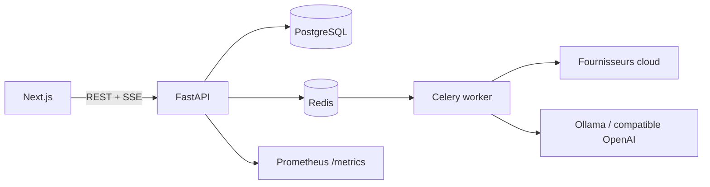

# Architecture backend — AI Agora

## Décisions structurantes

Le backend reste un service FastAPI modulaire. PostgreSQL est la source de
vérité transactionnelle ; Redis transporte les tâches Celery et pourra fournir
les verrous courts de l'orchestrateur. Ce choix reprend les bons découpages du
projet DBChat tout en retirant les dépendances MySQL, les valeurs de sécurité par
défaut et les responsabilités mêlées dans les routes.

## Modules

| Module | Responsabilité |
| --- | --- |
| `api/configs` | Configuration validée et garde-fous de production |
| `api/database` | Modèle SQLAlchemy et sessions courtes |
| `api/schemas` | Contrats publics camelCase et validation métier |
| `api/views` | Autorisation, orchestration de transaction et Swagger |
| `api/services` | Audit, événements, connecteurs fournisseurs et orchestration |
| `api/security.py` | bcrypt, JWT et chiffrement Fernet |
| `api/celery_app.py` | File de tâches durables |
| `alembic` | Migrations versionnées |

## Invariants déjà couverts

1. Chaque ressource métier appartient à un espace de travail et les accès
   étrangers répondent comme une ressource introuvable.
2. Une arène démarre avec au moins deux agents actifs et ne redémarre pas après
   son arrêt définitif.
3. Chaque arène réserve ses séquences d'événements sous verrou transactionnel.
4. Une clé d'idempotence rejouée renvoie la première arène ou le premier message.
5. Une réponse citée appartient obligatoirement à la même arène.
6. Les plafonds de messages et de coût sont vérifiés avant publication.
7. Les clés de fournisseurs sont chiffrées, absentes des réponses et des logs.
8. Les mises à jour concurrentes utilisent une version attendue et répondent
   `409 Conflict` en cas de donnée périmée.
9. Un événement humain ne produit qu’un message d’agent par clé idempotente.
10. Les tokens Ollama restent séparés des tokens et coûts cloud.

## Orchestration IA

Le worker utilise une interface commune pour Ollama et les API compatibles
OpenAI. Il vérifie les limites avant l’appel, favorise une mention explicite ou
l’agent ayant le moins contribué, exécute le fournisseur hors transaction
longue, puis revérifie l’état de la salle avant de persister message, usage et
événement. La clé dérivée de l’événement déclencheur empêche les doublons lors
d’une reprise Celery.

La suite ajoutera les décisions de silence ou réaction, les diagnostics finaux
plus riches et les verrous distribués pour les salles très concurrentes. Les
chaînes multi-agents sont déjà bornées par configuration et par les budgets.

Les WebSockets pourront être ajoutés si des commandes bidirectionnelles à faible
latence deviennent nécessaires. Pour le MVP, SSE suffit au flux serveur vers le
client et se reconnecte avec un curseur durable.
