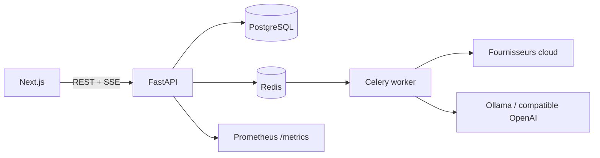

# Architecture backend — AI Agora

## Décisions structurantes

Le backend reste un service FastAPI modulaire. PostgreSQL est la source de
vérité transactionnelle ; Redis transporte les tâches Celery et pourra fournir
les verrous courts de l'orchestrateur. Ce choix reprend les bons découpages du
projet DBChat tout en retirant les dépendances MySQL, les valeurs de sécurité par
défaut et les responsabilités mêlées dans les routes.

## Modules

| Module | Responsabilité |
| --- | --- |
| `api/configs` | Configuration validée et garde-fous de production |
| `api/database` | Modèle SQLAlchemy et sessions courtes |
| `api/schemas` | Contrats publics camelCase et validation métier |
| `api/views` | Autorisation, orchestration de transaction et Swagger |
| `api/services` | Audit, événements et connecteurs fournisseurs |
| `api/security.py` | bcrypt, JWT et chiffrement Fernet |
| `api/celery_app.py` | File de tâches durables |
| `alembic` | Migrations versionnées |

## Invariants déjà couverts

1. Chaque ressource métier appartient à un espace de travail et les accès
   étrangers répondent comme une ressource introuvable.
2. Une arène démarre avec au moins deux agents actifs et ne redémarre pas après
   son arrêt définitif.
3. Chaque arène réserve ses séquences d'événements sous verrou transactionnel.
4. Une clé d'idempotence rejouée renvoie la première arène ou le premier message.
5. Une réponse citée appartient obligatoirement à la même arène.
6. Les plafonds de messages et de coût sont vérifiés avant publication.
7. Les clés de fournisseurs sont chiffrées, absentes des réponses et des logs.
8. Les mises à jour concurrentes utilisent une version attendue et répondent
   `409 Conflict` en cas de donnée périmée.

## Suite de l'orchestration IA

La prochaine tranche branchera le worker sur une interface commune de modèle :
entrée structurée, streaming, usage en tokens, coût, délai, erreurs normalisées
et annulation. Chaque tour réservera d'abord un événement, vérifiera de nouveau
le budget, exécutera le fournisseur hors transaction longue, puis persistera le
message et l'usage dans une transaction idempotente. Ce découpage permet de
reprendre une tâche après panne sans doubler une prise de parole.

Les WebSockets pourront être ajoutés si des commandes bidirectionnelles à faible
latence deviennent nécessaires. Pour le MVP, SSE suffit au flux serveur vers le
client et se reconnecte avec un curseur durable.
